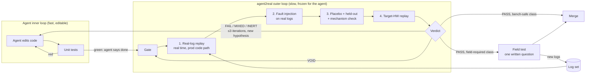
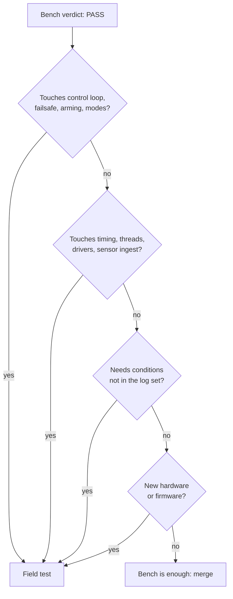

# Architecture

`agent2real` is a method and contains no code. This page shows where it sits in an agent's loop and
which pieces of your existing tooling it relies on.

## The two loops

There are two loops. The agent's inner loop runs fast and is cheap to game. The gate's outer loop
runs slower and the agent can't game it. The skill keeps the agent's "done" from being the end of
the work.



## Components

The skill depends on six components. You probably already have most of them under other names.

| Component | Role | Who may change it |
|---|---|---|
| **Log set** | Recorded field data; grows from every field failure and field test | Humans, in a separate change |
| **Held-out logs** | A subset used only for the verdict | Humans; replaced once used for tuning |
| **Replay harness** | Feeds logs into the **production** binary/launch at real time | Humans, in a separate change |
| **Fault injectors** | Edit real logs: drops, reorder, clock offset/jump, saturation, NaN, blur, CPU load | Humans, in a separate change |
| **Scorer** | Turns a run into metrics per log: median and worst case, never only the mean | Humans, in a separate change |
| **Target runner** | The same replay on the vehicle's board or SoC | Humans |

The agent can read all of these and run all of them. It can't edit any of them in the change it's
being judged on. That one rule (Rung 0) is what makes the rest trustworthy.

## The verdict record

Every idea that enters the gate leaves a short record. It's plain text or JSON, whatever your team
already uses:

```
id:          what changed (one line)
hypothesis:  "X improves because counter Y drops when Z happens"   ← written BEFORE the run
logs:        tuning set / held-out set (names or hashes)
faults:      which injectors, placements × seeds
placebo:     noise band per metric
result:      per-log median + worst case, vs baseline
counter:     did Y move?
verdict:     PASS | MIXED | FAIL | INERT | VOID
iteration:   1..3
field:       not needed | needed: <the one question>
```

The record is what a reviewer reads, and later what the next agent reads before it tries the same
idea again.

## Routing: bench or field



## Cost profile

| Rung | Typical cost | Runs on |
|---|---|---|
| Unit tests | seconds | every agent iteration |
| Real-log replay | minutes to an hour (real time) | every change the agent calls done |
| Faults × placements × seeds | hours, in parallel | changes to estimation, perception, control |
| Placebo + held-out | the same sweep plus one extra arm | any claimed improvement |
| Target-HW replay | the replay time on one board | before field, and before release |
| Field | a day and a team | only the field-required class |

The cheap rungs run often and the expensive ones run rarely. Because most ideas are rejected on the
cheap rungs, the expensive ones stay affordable.
